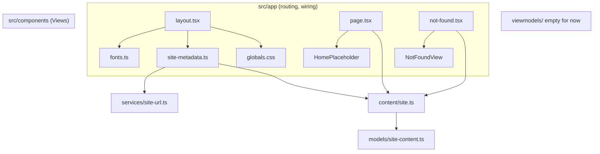

# Foundation Design

**Spec**: `.specs/features/foundation/spec.md`
**Status**: Draft

---

## Architecture Overview

Greenfield repo (no `src/` yet), so nothing to reuse. The design fixes the folder layout, the single source of each concern, and the automated boundaries that keep MVVM honest.

One source per concern:

| Concern | Single source | Consumers |
| ------- | ------------- | --------- |
| Colors, font tokens, focus ring, reduced motion | `src/app/globals.css` (`@theme` + `@layer base`) | Tailwind utilities, token tests (parse the CSS) |
| Font loading | `src/app/fonts.ts` (`next/font/google`) | `layout.tsx` (CSS variables), `@theme` (`--font-sans`, `--font-mono`) |
| User-facing text | `src/content/site.ts` (typed by `src/models/site-content.ts`) | metadata builder, views via `app/` wiring |
| Absolute URLs | `src/services/site-url.ts` (`normalizeSiteUrl`) | `src/app/site-metadata.ts` |
| Layer boundaries | `eslint.config.mjs` (`no-restricted-imports`) | `pnpm lint`, boundary tests |



Dependency direction: View → ViewModel → Model. In foundation the Views receive plain props from `app/` pages and no ViewModel exists yet, because there is no presentation logic to hold (the Home spec introduces the first one).

Tooling choices (versions verified on npm on 2026-11-06): Next.js 16.4.5, React 19, Tailwind CSS 4.3.5 with `@tailwindcss/postcss`, ESLint 10.14 with `eslint-config-next` 16.4.5 (peer `eslint >=9`), Vitest 5.1.0 with `@vitejs/plugin-react` 6.2.1 and `jsdom`, `@testing-library/react` 16.3.3. Node 24 (all engines satisfied).

---

## Code Reuse Analysis

### Existing Components to Leverage

None: the repository holds only `ui/` inputs and `.claude/` config. Reused inputs:

| Input | Location | How to Use |
| ----- | -------- | ---------- |
| Head snippet | `ui/head-snippet.html` | Port tag by tag into `site-metadata.ts`; strings go to `src/content/site.ts` |
| Favicons and OG image | `ui/images/` | Copy 7 files to `public/` (read-only input, never imported) |
| Color/typography values | `ui/Site vitrine pessoal.html`, board "Sistema visual" | Transcribe into `@theme` |

### Integration Points

| System | Integration Method |
| ------ | ------------------ |
| Google Fonts | Fetched at `pnpm build` by `next/font/google`, served from the site afterward |
| Env | `NEXT_PUBLIC_SITE_URL`, documented in `.env.example` |

---

## Components

### Design tokens

- **Purpose**: Hold the dark visual system once.
- **Location**: `src/app/globals.css`
- **Interfaces** (Tailwind theme variables):
  - Colors: `--color-bg #0B0B10`, `--color-card-from #16161F`, `--color-card-to #101018`, `--color-brand #881E9B` (fills, borders, glow only), `--color-brand-text #C77DDB`, `--color-brand-light #E3B5F0`, `--color-brand-hover #9B2BAF`, `--color-brand-pressed #6F1780`, `--color-fg #ECEAF3`, `--color-fg-muted #A9A6BA`, `--color-line rgb(255 255 255 / 0.08)`.
  - Fonts: `--font-sans` → `var(--font-manrope)`, `--font-mono` → `var(--font-jetbrains-mono)`.
  - Base layer: `body` (bg, fg, `color-scheme: dark`, `font-family`), `:focus-visible` (`outline: 2px solid var(--color-brand-light); outline-offset: 3px`), `@media (prefers-reduced-motion: reduce)` (`transition: none !important; animation: none !important` on `*`).
- **Dependencies**: Tailwind 4 (`@import "tailwindcss"`).
- **Reuses**: values from the "Sistema visual" board.

### Fonts

- **Purpose**: Load Manrope and JetBrains Mono self-hosted.
- **Location**: `src/app/fonts.ts`
- **Interfaces**: `export const manrope`, `export const jetbrainsMono` (`next/font/google`, `variable: "--font-manrope"` / `"--font-jetbrains-mono"`, `display: "swap"`, `subsets: ["latin", "latin-ext"]`, Manrope weights 400-800, JetBrains Mono 400-600).
- **Dependencies**: `next/font`.
- **Reuses**: n/a.

### Site content

- **Purpose**: Typed PT-BR copy for site-level text.
- **Location**: `src/models/site-content.ts` (type), `src/content/site.ts` (data)
- **Interfaces**:
  ```ts
  export interface SiteContent {
    name: string            // "Rafael Couto Silva"
    title: string           // "Rafael Couto Silva · Especialista Full Stack"
    description: string     // "Do requisito à produção, guiado por especificações."
    ogImageAlt: string      // alt text from head-snippet.html
    notFound: { title: string; message: string; backLabel: string }
  }
  export const siteContent: SiteContent
  ```
- **Dependencies**: none (pure TS).
- **Reuses**: strings from `ui/head-snippet.html`; 404 copy is new PT-BR text.

### Site URL

- **Purpose**: Turn the env value into a safe origin.
- **Location**: `src/services/site-url.ts`
- **Interfaces**: `normalizeSiteUrl(raw: string | undefined): string`
  - `undefined` or empty/whitespace → `"http://localhost:3000"`.
  - Strips trailing slashes: `"https://x.com/"` → `"https://x.com"`.
  - Not an absolute `http:`/`https:` URL → throws `Error("NEXT_PUBLIC_SITE_URL must be an absolute http(s) URL, got: ...")`.
- **Dependencies**: global `URL` only (no React, no Next).
- **Reuses**: n/a.

### Metadata builder

- **Purpose**: Build the Next `Metadata` and `Viewport` objects from content + site URL.
- **Location**: `src/app/site-metadata.ts`
- **Interfaces**:
  - `buildSiteMetadata(content: SiteContent, siteUrl: string): Metadata` → `metadataBase`, `title`, `description`, `icons` (svg, ico 48x48, png 32x32, apple 180x180), `openGraph` (type website, locale pt_BR, url `siteUrl + "/"`, image `/og-image.png` 1200x630 with alt), `twitter` (`summary_large_image`, title, description, image).
  - `siteViewport: Viewport` → `themeColor: "#0B0B10"`, `colorScheme: "dark"`.
- **Dependencies**: `next` types (allowed in `app/`), `SiteContent`.
- **Reuses**: n/a.

### Layout and pages

- **Purpose**: Wire fonts, CSS, metadata and views.
- **Location**: `src/app/layout.tsx`, `page.tsx`, `not-found.tsx`
- **Interfaces**: `layout.tsx` exports `metadata = buildSiteMetadata(siteContent, normalizeSiteUrl(process.env.NEXT_PUBLIC_SITE_URL))` and `viewport = siteViewport`; renders `<html lang="pt-BR" className={`${manrope.variable} ${jetbrainsMono.variable}`}>`. `page.tsx` renders `<HomePlaceholder title={siteContent.name} />`. `not-found.tsx` renders `<NotFoundView {...siteContent.notFound} />`.
- **Dependencies**: all of the above. Server Components only, no `"use client"`.
- **Reuses**: n/a.

### Views

- **Purpose**: Dumb presentational components.
- **Location**: `src/components/HomePlaceholder.tsx`, `src/components/NotFoundView.tsx`
- **Interfaces**: `HomePlaceholder({ title }: { title: string })` renders `<main><h1>{title}</h1></main>`; `NotFoundView({ title, message, backLabel })` renders `<main>` with `<h1>`, message and `<a href="/">{backLabel}</a>`.
- **Dependencies**: Tailwind classes using the tokens; no content imports.
- **Reuses**: tokens.

### Boundary rules

- **Purpose**: Make AC "no `react`/`next` in Model" and "no `ui/` import" fail the build.
- **Location**: `eslint.config.mjs` (flat config: `eslint-config-next` core-web-vitals + typescript, then overrides).
- **Interfaces**:
  - `files: ["src/models/**", "src/services/**"]` → `no-restricted-imports` patterns for `react`, `react/*`, `react-dom`, `react-dom/*`, `next`, `next/*`.
  - `files: ["src/**"]` → `no-restricted-imports` regex `^(\.\./)+ui(/|$)` and `^ui(/|$)`. The regex is anchored so a future `src/components/ui/` folder does not trip it.
- **Dependencies**: ESLint 10, `eslint-config-next`.
- **Reuses**: n/a.

### Public assets

- **Purpose**: Static files referenced by metadata.
- **Location**: `public/{favicon.svg,favicon.ico,favicon-32.png,favicon-180.png,favicon-192.png,favicon-512.png,og-image.png}`
- **Notes**: `ui/images/og-image.png` is already 1200×630 (checked). The 2.1 MB portrait and the Trello screenshot are not copied now; their specs copy and optimize them.

---

## File layout (end state of Foundation)

```
.env.example                  NEXT_PUBLIC_SITE_URL=
eslint.config.mjs  postcss.config.mjs  tsconfig.json
vitest.config.ts  package.json  pnpm-lock.yaml
public/                       7 files
src/app/                      layout.tsx page.tsx not-found.tsx globals.css fonts.ts site-metadata.ts
src/components/               HomePlaceholder.tsx NotFoundView.tsx
src/content/                  site.ts
src/models/                   site-content.ts
src/services/                 site-url.ts
src/viewmodels/               .gitkeep
tests/                        mirrors src/ + setup.ts, lint/, structure.test.ts
```

---

## Test plan (spec → tests, all assert spec outcomes)

| Req | Test file | Asserts |
| --- | --------- | ------- |
| FND-01 | `tests/scripts.test.ts` | `package.json` defines `dev`, `build`, `lint`, `typecheck`, `test`; gate runs the real commands, `curl /` → 200 on `pnpm dev`/`start` |
| FND-02 | `tests/structure.test.ts` | `tsconfig.json` has `strict: true`; the 6 `src/` dirs exist; every `tests/**/*.test.*` has a mirrored `src/` path or lives in a named infra folder (`lint/`) |
| FND-03 | `tests/lint/boundaries.test.ts` | `ESLint.lintText` on `src/models/x.ts` with `import "react"` → error; `src/services/x.ts` with `import "next/image"` → error; `src/app/x.ts` with `import "../../ui/a"` → error; clean code → no error |
| FND-04 | `tests/app/tokens.test.ts` | parses `@theme` in `globals.css`: all 10 color values, font tokens; `body` rule; no `text-brand` utility (regex `\btext-brand(?![-\w])`) or `color: var(--color-brand)` in `src/**` |
| FND-05 | `tests/app/tokens.test.ts` | `contrastRatio(fg, bg)`, `(fg-muted, bg)`, `(brand-text, bg)` each ≥ 4.5; focus rule is `2px solid #E3B5F0` / offset `3px`; reduced-motion block exists; `fonts.ts` uses `next/font/google` and no `<link>` to `fonts.googleapis.com` in `src/` |
| FND-06 | `tests/app/site-metadata.test.ts`, `tests/services/site-url.test.ts` | every OG/Twitter/theme/viewport value from the spec; URLs use `siteUrl`; no `SEU-DOMINIO`; trailing slash, fallback, invalid URL throws |
| FND-07 | `tests/app/public-assets.test.ts` | 7 files exist, `og-image.png` IHDR is 1200×630; every asset path referenced by metadata exists; gate: `curl -I /og-image.png` → 200 `image/png` |
| FND-08 | `tests/content/site.test.ts` | content matches head-snippet strings; metadata title follows content (inject alternate content) |
| FND-09 | `tests/components/*.test.tsx`, `tests/app/page.test.tsx` | `HomePlaceholder` renders one `<h1>` with the name; `NotFoundView` renders `<h1>` and a link to `/`; gate: `curl /` 200, `/nao-existe` 404 |

Helper `contrastRatio` (WCAG relative luminance) lives in `tests/helpers/contrast.ts`, since only tests use it. It gets its own test against known pairs (black/white = 21, spec's `#881E9B` on `#0B0B10` < 3).

Accepted limitation: jsdom does not run Tailwind, so token behavior (body styles, focus outline, reduced motion) is asserted on the CSS source. The compiled CSS is checked once with `curl` during Verify.

---

## Error Handling Strategy

| Error Scenario | Handling | User Impact |
| -------------- | -------- | ----------- |
| `NEXT_PUBLIC_SITE_URL` unset | Fall back to `http://localhost:3000` | None locally; production must set it |
| `NEXT_PUBLIC_SITE_URL` invalid | `normalizeSiteUrl` throws, build fails | Build stops with a message naming the variable |
| Unknown route | `not-found.tsx` | Dark PT-BR 404 page with link home, HTTP 404 |
| Google Fonts unreachable at build | `next build` fails | CI/local build stops; runtime unaffected |
| Public asset missing | `public-assets` test fails | Caught before merge |

---

## Risks & Concerns

| Concern | Location | Impact | Mitigation |
| ------- | -------- | ------ | ---------- |
| `next/font/google` needs network at build time | `src/app/fonts.ts` | Offline or restricted CI cannot build | Accepted. Fallback if it bites: `next/font/local` with the Latin woff2 files bundled in the design (only Latin subset, so accents covered, other ranges not) |
| Bleeding-edge majors (Next 16, ESLint 10, Vitest 5, Tailwind 4) | `package.json` | Plugin incompatibilities appear late | Peer deps checked; first task scaffolds and runs all five scripts green before any feature code |
| `ui/Site vitrine pessoal.html` is 5 MB | `ui/` | Bloats the repo and every clone | Decide before the first commit: commit it (design is the source of truth) or `.gitignore` it and keep only `ui/images` + `head-snippet.html`; surfaced to the user |
| Token tests parse CSS text | `tests/app/tokens.test.ts` | A refactor of CSS formatting breaks tests without behavior change | Parse declarations, not raw strings; one small `readThemeTokens()` helper |
| Hero PNG is 2.1 MB | `ui/images/` | Slow LCP when used | Not copied now; the Home spec optimizes it via `next/image` (see spec assumption) |
| No automated check for hardcoded PT-BR in components | `src/components/` | Copy leaks into JSX | Spec AC 3 of the content story defers to code review; rule goes in `CLAUDE.md` |

---

## Tech Decisions (only non-obvious ones)

| Decision | Choice | Rationale |
| -------- | ------ | --------- |
| Token source of truth | CSS `@theme`, tests parse it | Tailwind 4 reads tokens from CSS, not TS; a TS twin would drift (see AD-001) |
| Metadata builder placement | `src/app/site-metadata.ts`, not `services/` | It imports `next` types, which the Model layer forbids |
| URL normalization placement | `src/services/site-url.ts`, pure | Testable without Next; keeps `app/` thin |
| Lint rules for MVVM boundaries | `no-restricted-imports` + ESLint API tests | Turns the CLAUDE.md rule into a failing build (see AD-002) |
| Lint command | `eslint .` (Next 16 removed `next lint`) | Run ESLint directly with the flat config |
| Path alias | `@/*` → `src/*` | Short imports; works in Next, Vitest (`vite-tsconfig-paths` or explicit alias) |
| Empty ViewModel dir | `.gitkeep` | Spec AC requires the directory; no fake ViewModel invented |
| Asset policy | Copy only the 7 assets metadata needs | Photo and screenshot ship with the page that uses them |
