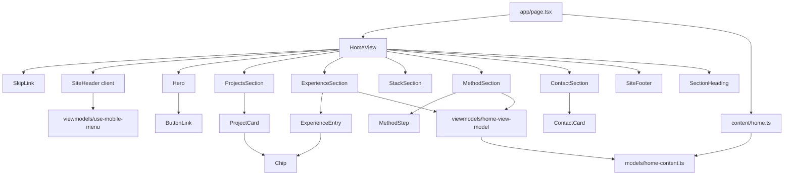

# Home Design

**Spec**: `.specs/features/home/spec.md`
**Status**: Draft

---

## Architecture Overview

The Home is a Server Component page that passes typed PT-BR content to dumb Views. Presentation rules (hide an empty period, omit an empty "IA" row, mobile menu state) live in `src/viewmodels/`. The only client component is `SiteHeader`, which needs menu state.

Approaches considered:

| | Approach | Trade-off |
| - | -------- | --------- |
| A (chosen) | One typed `homeContent` object in `src/content/home.ts`; small pure view-model functions per concern plus one hook (`useMobileMenu`); one View file per component; `HomeView` composes them | Fits MVVM and the one-component-per-task rule; each slice is reviewable alone. More files. |
| B | One hook per section | Sections have no state; hooks would be empty wrappers. Rejected. |
| C | Everything in `page.tsx` | Breaks the View/ViewModel split and the "no PT-BR in app/" rule. Rejected. |



Dependency direction stays View → ViewModel → Model. `src/models/home-content.ts` has no React or Next imports (AD-002).

---

## Code Reuse Analysis

### Existing Components to Leverage

| Component | Location | How to Use |
| --------- | -------- | ---------- |
| Design tokens | `src/app/globals.css` | Use `bg-bg`, `text-fg`, `text-fg-muted`, `text-brand-text`, `border-line`, `bg-brand` utilities. Never `text-brand` (AD-001). |
| Fonts | `src/app/fonts.ts` | `font-sans`, `font-mono` utilities already mapped. |
| Content pattern | `src/content/site.ts`, `src/models/site-content.ts` | Same split: type in `models/`, data in `content/`. |
| Test pattern for "no hardcoded text" | `tests/components/HomePlaceholder.test.tsx` | Reuse the regex-on-source check for every new View. |
| Folder-mirror guard | `tests/structure.test.ts` | Every new `src/**` file needs its mirrored `tests/**` file. |
| Contrast helper | `tests/helpers/contrast.ts` | Reuse in the "no `text-brand`" guard test. |
| Public asset test | `tests/app/public-assets.test.ts` | Extend with the portrait and CV. |

### Integration Points

| System | Integration Method |
| ------ | ------------------ |
| `next/image` | Hero portrait, `priority`, `width`/`height` 1254, rendered at ~360 px with `sizes`. |
| Browser anchors | Section ids `projetos`, `experiencia`, `stack`, `metodo`, `contato`; `top`; `conteudo`. |
| `public/` | `rafael-portrait.png`, `cv-rafael-couto-silva.pdf`. |

---

## Components

All Views live flat in `src/components/`. Texts always arrive as props from `src/content/home.ts`; no PT-BR literals in JSX.

### Content and model

- **Purpose**: Typed PT-BR copy for every block.
- **Location**: `src/models/home-content.ts` (types), `src/content/home.ts` (data `homeContent`).
- **Interfaces**:
  ```ts
  export interface Link { label: string; href: string; external?: boolean }
  export interface Metric { label: string; value: string }
  export interface HomeContent {
    chrome: {
      skipLinkLabel: string; mainId: string; topId: string
      nav: { ariaLabel: string; links: { label: string; sectionId: string }[] }
      menuButton: { openLabel: string; closeLabel: string }
      footer: { copyright: string; backToTop: Link }
    }
    hero: {
      label: string; headline: string; badge: string; intro: string
      stackLine: string[]; actions: { contact: Link; cv: Link }
      portrait: { src: string; width: number; height: number; alt: string; caption: string }
    }
    projects: { sectionId: string; eyebrow: string; title: string; items: ProjectCard[] }
    experience: { sectionId: string; eyebrow: string; title: string; entries: ExperienceEntry[] }
    stack: { sectionId: string; eyebrow: string; title: string; main: {name: string; note: string}[]; mainNote: string; otherLabel: string; others: string[] }
    method: { sectionId: string; eyebrow: string; title: string; intro: string; roleLabels: { human: string; ai: string }; steps: MethodStep[]; summary: string; link: Link }
    contact: { sectionId: string; eyebrow: string; title: string; lead: string; cv: Link; whatsappButton: Link; channels: { id: "email"|"linkedin"|"github"|"whatsapp"; label: string; value: string; href: string; external?: boolean }[] }
  }
  export interface ProjectCard { id: string; context: string[]; title: string; description: string; metrics: Metric[]; tags: string[]; caseLink: Link; repoLink?: Link }
  export interface ExperienceEntry { company: string; period?: string; duration?: string; role: string; achievements: { lead?: string; text: string }[]; tags: string[]; note?: string; link?: Link }
  export interface MethodStep { number: string; title: string; human: string; ai?: string; highlight?: boolean }
  ```
- **Dependencies**: none (pure TS).
- **Reuses**: pattern of `site.ts`.

### ViewModels

- **Purpose**: Presentation rules kept out of JSX.
- **Location**: `src/viewmodels/use-mobile-menu.ts`, `src/viewmodels/home-view-model.ts`.
- **Interfaces**:
  - `useMobileMenu(): { isOpen: boolean; toggle(): void; close(): void }` - closes on Escape while open; removes the listener on close/unmount.
  - `toExperienceEntryView(entry: ExperienceEntry): ExperienceEntryView` - `period` becomes `undefined` when empty or whitespace; empty `tags` / `achievements` stay empty arrays (the View renders no container).
  - `toMethodStepView(step: MethodStep): MethodStepView` - `ai` is `undefined` when empty, so no "IA" row.
  - `hasItems<T>(list: readonly T[] | undefined): list is T[]` - non-empty check used by Views for "no empty container".
- **Dependencies**: React (`useState`, `useEffect`) in the hook only; the file is the only `viewmodels` file importing React.
- **Reuses**: n/a.

### Primitives

| Component | Location | Purpose | Props |
| --------- | -------- | ------- | ----- |
| `Icon` | `src/components/Icon.tsx` | Decorative inline SVG (`aria-hidden`) for download, mail, linkedin, github, whatsapp, menu, close, arrow. | `name`, `className?` |
| `ButtonLink` | `src/components/ButtonLink.tsx` | Anchor styled as primary/ghost button; external links get `target="_blank" rel="noopener noreferrer"`; `download` attribute option. | `link: Link`, `variant`, `icon?`, `download?` |
| `Chip` | `src/components/Chip.tsx` | Mono tag; `main` variant uses brand border/fill. | `label`, `main?` |
| `SectionHeading` | `src/components/SectionHeading.tsx` | Eyebrow with `aria-hidden` number + `h2` with `id` for `aria-labelledby`. | `eyebrow`, `title`, `id` |

### Page blocks

| Component | Location | Purpose |
| --------- | -------- | ------- |
| `SkipLink` | `src/components/SkipLink.tsx` | First focusable element, targets `#conteudo`; visible only on focus. |
| `SiteHeader` | `src/components/SiteHeader.tsx` | `"use client"`. Sticky header: brand + `nav` (hidden below `md`) + menu button (`aria-expanded`, `aria-controls`) + panel. Uses `useMobileMenu`. |
| `Hero` | `src/components/Hero.tsx` | Label, `h1`, SDD badge, intro, stack line, two `ButtonLink`s, `next/image` portrait with caption. |
| `ProjectCard` | `src/components/ProjectCard.tsx` | `article` with `h3`, metrics, `Chip`s, stretched "Ver o caso" link, optional repo link above the stretched layer. |
| `ProjectsSection` | `src/components/ProjectsSection.tsx` | `section#projetos`, `aria-labelledby`, two cards. |
| `ExperienceEntry` | `src/components/ExperienceEntry.tsx` | Timeline item with `h3`, role, optional period, achievements (bold lead-in), `Chip`s, optional note/link. |
| `ExperienceSection` | `src/components/ExperienceSection.tsx` | `section#experiencia`, entries in order. |
| `StackSection` | `src/components/StackSection.tsx` | `section#stack`: three "fio principal" chips and the secondary list. |
| `MethodStep` | `src/components/MethodStep.tsx` | Numbered step with "Eu" row and optional "IA" row; `highlight` marks the red-test step. |
| `MethodSection` | `src/components/MethodSection.tsx` | `section#metodo`: intro, six steps, summary line, link. |
| `ContactCard` | `src/components/ContactCard.tsx` | One channel as a link card with icon. |
| `ContactSection` | `src/components/ContactSection.tsx` | `section#contato`: lead, CV and WhatsApp buttons, four channel cards. |
| `SiteFooter` | `src/components/SiteFooter.tsx` | Copyright and "Voltar ao topo" to `#top`. |
| `HomeView` | `src/components/HomeView.tsx` | Composes everything in order inside `div#top` and `main#conteudo`; replaces `HomePlaceholder`. |

`src/app/page.tsx` becomes `<HomeView content={homeContent} />`.

---

## Data Models

Defined in the Components section above (`HomeContent` and children). Content is static; there is no persistence.

Decorative section numbers ("01".."05") are part of `eyebrow` strings and rendered inside an `aria-hidden` span by `SectionHeading` (the number is split from the label by the first ` · `).

---

## Error Handling Strategy

| Error Scenario | Handling | User Impact |
| -------------- | -------- | ----------- |
| Entry has no period | `toExperienceEntryView` returns `period: undefined`; View renders nothing for it | No empty element. |
| Step has no "IA" text | `toMethodStepView` returns `ai: undefined` | No "IA" row. |
| Empty tag/metric list | `hasItems` false; View skips the container | No empty block. |
| `/cv-rafael-couto-silva.pdf` missing | Asset test fails the gate (T2) | Cannot ship a 404 CV. |
| `/casos/*` not built yet | Next serves the Foundation 404 page | Known interim state (spec Assumptions). |
| JavaScript disabled | Header links render server-side; only the menu toggle needs JS | Inline nav works on desktop; mobile has no menu. |

---

## Risks & Concerns

| Concern | Location (file:line) | Impact | Mitigation |
| ------- | -------------------- | ------ | ---------- |
| `HomePlaceholder` and its tests become dead code | `src/components/HomePlaceholder.tsx`, `tests/components/HomePlaceholder.test.tsx`, `tests/app/page.test.tsx` | Lint/test noise, structure guard keeps them alive | Remove in the assembly task together with the page rewrite. |
| Folder-mirror guard rejects tests without a matching source file | `tests/structure.test.ts` | A test for a not-yet-created file fails the gate | Each task creates source and test in the same commit. |
| Decorative gradient/grid background is CSS-heavy | design board `.site` rules | Hard to unit test; may drift | Put it in one class on `HomeView`; assert the class exists, verify visually on offer to the user (browser only after approval). |
| Whole-card link overlay hides the inner repo link | `ProjectCard` | Repo link unclickable | Repo link gets `relative z-10`; test asserts both hrefs. |
| Hero image is 2 MB PNG | `public/rafael-portrait.png` | LCP regression | Served via `next/image` (AVIF/WebP resize) with `priority`; originals stay out of the client bundle. |
| Personal phone number published in repo content | `src/content/home.ts` | Spam exposure | Author chose to publish it (spec Assumptions, confirmed). |

---

## Tech Decisions (only non-obvious ones)

| Decision | Choice | Rationale |
| -------- | ------ | --------- |
| Where WhatsApp number lives | `src/content/home.ts` as `https://wa.me/5524999644346` | No env var; the link always renders (confirmed by author). |
| Section number rendering | Split `eyebrow` on first ` · ` in `SectionHeading` | Keeps the number `aria-hidden` without a second content field. |
| Sticky header offset | `scroll-mt-24` on each section | Anchors do not hide the heading under the header (spec edge case). |
| Menu markup | Panel rendered only while open; button has `aria-controls` pointing at it | Simple, testable, no hidden-focus traps. |
| Component folder | Flat `src/components/` | Matches Foundation and the mirror guard; ~20 files stay readable. |

> No new project-level decision: AD-001 and AD-002 are followed unchanged.
